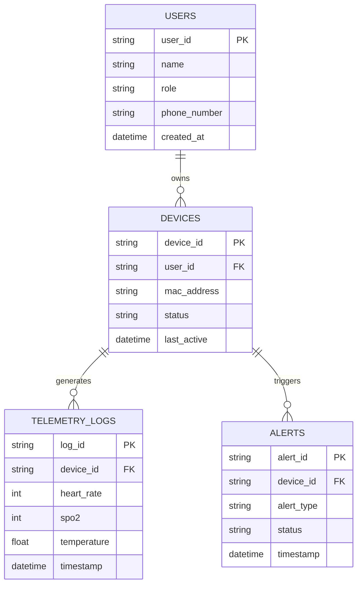
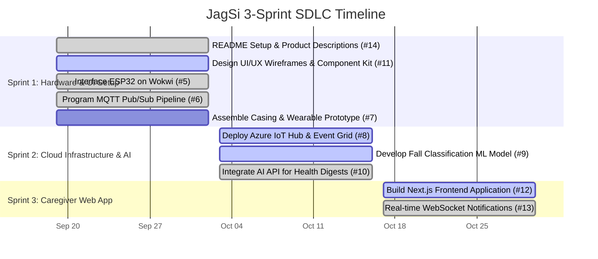

# JagSi (Jaga Lansia) — Senior Project Documentation

**Live Documentation Portal**: [https://akhnafyooga.github.io/JagSi/](https://akhnafyooga.github.io/JagSi/)

---

## Product Goals
To build an accessible, cloud-connected wearable health-monitoring ecosystem that provides real-time vital sign tracking, automated fall detection, emergency alerts, and AI-driven health risk summaries for elderly individuals and their primary caregivers.

---

## Potential Users and Needs
* **Elderly Individuals**: Require simple, non-intrusive wearable hardware equipped with vital sensors and an accessible physical SOS button with zero UI learning curve.
* **Family Caregivers**: Require a web dashboard offering live health metrics, instant push notifications for fall events, and simplified AI explanations of telemetry.
* **Healthcare Providers**: Require organized historical health trends (heart rate, SpO2, temperature) to evaluate overall patient conditions.

---

## Functional Requirements

| FR | Description |
| :--- | :--- |
| **FR 1** | The simulated ESP32 wearable must collect and stream heart rate, SpO2, and body temperature telemetry to Azure IoT Hub via MQTT every 10 seconds. |
| **FR 2** | The cloud backend must process accelerometer/gyroscope vectors using an ML model to detect fall impacts and dispatch emergency alerts within 5 seconds. |
| **FR 3** | The system must allow users to trigger a manual emergency SOS alert by holding the wearable’s physical button for >2 seconds. |
| **FR 4** | The web dashboard must integrate the Gemini API to analyze raw telemetry and deliver simplified health risk summaries in Bahasa Indonesia. |

---

## Entity Relationship Diagram (ERD)

## Gantt-Chart or Sprint Status

Sprint 1 is the original plan. Sprints 2 and 3 continue its two-week cadence;
the block was cut off after the first Sprint 2 task (an incomplete end date
stopped Mermaid from drawing the chart at all) and was completed in Week 8.

### Status per issue (Week 8)

| Issue | Status | Where it stands |
|-------|--------|-----------------|
| #5 ESP32 + sensors on Wokwi | Done | `firmware/jagsi-watch`, Week 6 |
| #6 MQTT pub/sub pipeline | Done | `docs/mqtt-contract.md`, 22-check integration test |
| #7 Casing & wearable prototype | Not started | needs the physical parts (`docs/hardware-bom.md`) |
| #8 Azure IoT Hub & Event Grid | In progress | code and tests done (Week 7); waiting for the team's Azure subscription |
| #9 Fall classification model | In progress | re-tune tooling done (Week 7); waiting for recordings from the physical MPU6050 |
| #10 Gemini health digest | Done | Week 7; default model fixed to `gemini-3.8-flash` in Week 8 |
| #11 UI/UX wireframes | In progress | low-fidelity wireframe below |
| #12 Next.js frontend | In progress | Beranda and Darurat are live; Monitoring and Riwayat still show demo data |
| #13 Real-time notifications | Done | Week 8: `/ws/alerts`, emergency screen, alarm, system notification |
| #14 README & descriptions | Done | README updated to the real structure in Week 8 |

## UI/UX Design & Low-Fidelity Wireframe
UI/UX Design & Low-Fidelity Wireframes
Below is the initial low-fidelity component breakdown for the JagSi Caregiver Web App:

Header: Navigation bar, real-time status/alerts indicator, user profile.

Alert Banner: Prominent notification strip for critical fall events or manual emergency SOS triggers.

Telemetry Grid: Live monitoring cards for Heart Rate, SpO2, Body Temperature, and Battery status.

AI Health Digest: Section summarizing daily vital trends via Gemini API in Bahasa Indonesia.

AI Chat Assistant: Interactive prompt area for caregiver health queries and AI-assisted updates.
