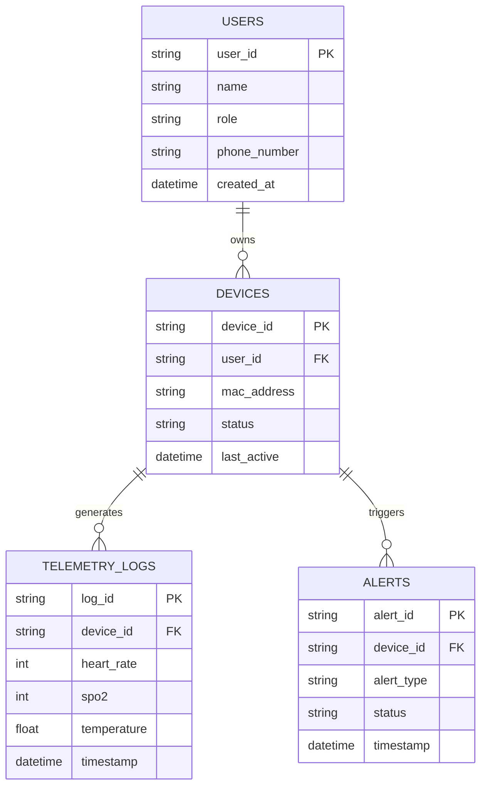
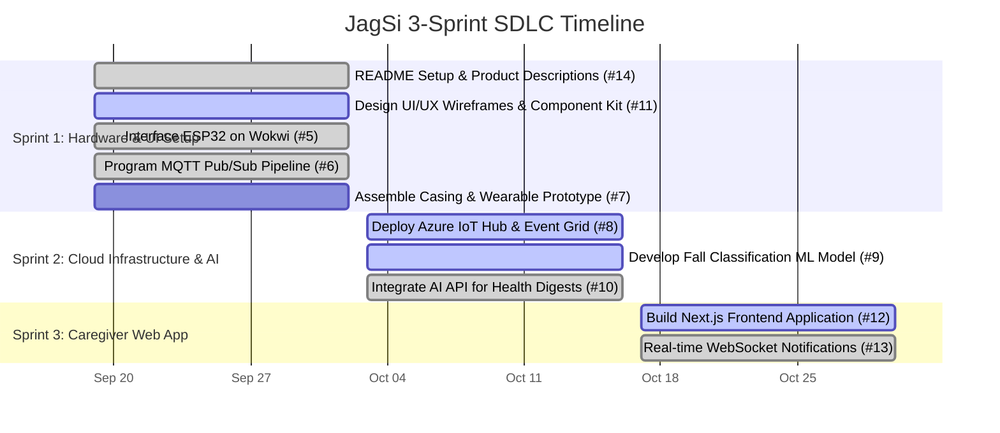

# JagSi (Jaga Lansia) — Senior Project Documentation

**Live Documentation Portal**: [https://akhnafyooga.github.io/JagSi/](https://akhnafyooga.github.io/JagSi/)

---

## Wokwi delivery alignment

The [implementation and team requirements](wokwi-team-requirements.md) specify the current simulation demonstration. This work uses JagSi-trained models and Supabase cloud persistence.

| Work package | Owner | Complexity | State |
| --- | --- | --- | --- |
| [#20 Wokwi and owned ML models](https://github.com/akhnafyooga/JagSi/issues/20) | Akhnaf | L4 high | Open |
| [#21 Cloud and backend inference](https://github.com/akhnafyooga/JagSi/issues/21) | Rafi | L4 high | Open |
| [#22 Dashboard and acceptance](https://github.com/akhnafyooga/JagSi/issues/22) | Akmal | L3 medium | Open |

## Product Goals
To build an accessible, cloud-connected wearable health-monitoring ecosystem that provides real-time vital sign tracking, automated fall detection, emergency alerts, and AI-driven health risk summaries for elderly individuals and their primary caregivers.

---

## Potential Users and Needs
* **Elderly Individuals**: Require simple, non-intrusive wearable hardware equipped with vital sensors and an accessible physical SOS button with zero UI learning curve.
* **Family Caregivers**: Require a web dashboard offering live health metrics, instant push notifications for fall events, and simplified AI explanations of telemetry.
* **Healthcare Providers**: Require organized historical health trends (heart rate, SpO2, temperature) to evaluate overall patient conditions.

---

## Functional Requirements

| FR | Description |
| :--- | :--- |
| **FR 1** | The simulated ESP32 wearable must collect and stream heart rate, SpO2, and body temperature telemetry to Azure IoT Hub via MQTT every 10 seconds. |
| **FR 2** | The cloud backend must process accelerometer/gyroscope vectors using an ML model to detect fall impacts and dispatch emergency alerts within 5 seconds. |
| **FR 3** | The system must allow users to trigger a manual emergency SOS alert by holding the wearable’s physical button for >2 seconds. |
| **FR 4** | The web dashboard must integrate the Gemini API to analyze raw telemetry and deliver simplified health risk summaries in Bahasa Indonesia. |

---

## Entity Relationship Diagram (ERD)

<<<<<<< HEAD
## Gantt-Chart or Sprint Status

Sprint 1 is the original plan. Sprints 2 and 3 continue its two-week cadence;
the block was cut off after the first Sprint 2 task (an incomplete end date
stopped Mermaid from drawing the chart at all) and was completed in Week 8.

=======
## Sprint Status

**17 November 2026**

| Sprint | Status | Progress and remaining work |
| --- | --- | --- |
| 1. Planning and documentation | Complete | Product scope, functional requirements, ERD and the Pages portal are in place ([#14](https://github.com/akhnafyooga/JagSi/issues/14)). |
| 2. Hardware simulation and UI design | In progress | MQTT pub/sub was validated with Wokwi and a public broker ([#6](https://github.com/akhnafyooga/JagSi/issues/6), [PR #17](https://github.com/akhnafyooga/JagSi/pull/17)). The Week 6 branch records the physical and simulated sensor configurations ([#5](https://github.com/akhnafyooga/JagSi/issues/5)). Wireframes and the dashboard exist. Wireframes and the UI kit are closed ([#11](https://github.com/akhnafyooga/JagSi/issues/11)). Physical assembly remains open ([#7](https://github.com/akhnafyooga/JagSi/issues/7)). |
| 3. Cloud ingestion | In progress | The [Week 6 PR](https://github.com/akhnafyooga/JagSi/pull/18) provides a development MQTT-to-SQLite bridge and API. Week 7 reports 17/17 local Event Grid replay checks. Publish the tested revision and validate X.509 device traffic and direct-method acknowledgments on Azure ([#8](https://github.com/akhnafyooga/JagSi/issues/8)). |
| 4. Fall detection and caregiver AI | In progress | The reproducible classifier and device-format validation are available. Week 7 reports synthetic calibration tooling and summary and chat with a labelled rule-based fallback. The [calibration protocol](fall-calibration.md) is complete ([#19](https://github.com/akhnafyooga/JagSi/issues/19)). Physical MPU6050 recordings, held-out model evaluation and live Gemini requests remain open ([#9](https://github.com/akhnafyooga/JagSi/issues/9), [#10](https://github.com/akhnafyooga/JagSi/issues/10)). |
| 5. Caregiver dashboard | In progress | The Next.js screens are implemented on the frontend branch ([#12](https://github.com/akhnafyooga/JagSi/issues/12)). PR #18 demonstrates SSE vitals with polling and demo fallback. Verify audible emergency notifications and agree on the transport acceptance criterion ([#13](https://github.com/akhnafyooga/JagSi/issues/13)). |
| 6. System validation and release | In progress | Week 6 reports 22 local end-to-end bridge checks and 22 frontend tests. Week 7 reports 103 backend and 31 frontend tests pending a published commit and CI run. Physical hardware, live services and a CI run that enforces backend test failures remain pending. |

### Sprint issue diagram

This snapshot shows GitHub issue states as of 17 November 2026. Sprint 6 validation is tracked across the existing hardware, cloud, model, AI and notification issues.

- **Open:** [#5 Wokwi sensors](https://github.com/akhnafyooga/JagSi/issues/5), [#7 wearable assembly](https://github.com/akhnafyooga/JagSi/issues/7), [#8 Azure ingestion](https://github.com/akhnafyooga/JagSi/issues/8), [#9 fall model](https://github.com/akhnafyooga/JagSi/issues/9), [#10 AI health digests](https://github.com/akhnafyooga/JagSi/issues/10), and [#13 emergency notifications](https://github.com/akhnafyooga/JagSi/issues/13).
- **Closed:** [#6 MQTT pipeline](https://github.com/akhnafyooga/JagSi/issues/6), [#12 Next.js frontend](https://github.com/akhnafyooga/JagSi/issues/12), [#14 initial documentation](https://github.com/akhnafyooga/JagSi/issues/14), [#11 wireframes and component kit](https://github.com/akhnafyooga/JagSi/issues/11), and [#19 calibration protocol](https://github.com/akhnafyooga/JagSi/issues/19).

### Published development evidence

- [MQTT contract](https://github.com/akhnafyooga/JagSi/blob/b6278df5fbc6444be805a0cb0970a5b24665981f/docs/mqtt-contract.md) and [hardware bill of materials](https://github.com/akhnafyooga/JagSi/blob/b6278df5fbc6444be805a0cb0970a5b24665981f/docs/hardware-bom.md).
- [Week 6 validation](https://github.com/akhnafyooga/JagSi/blob/b6278df5fbc6444be805a0cb0970a5b24665981f/docs/week6-validation.md) and [live dashboard capture](https://github.com/akhnafyooga/JagSi/blob/b6278df5fbc6444be805a0cb0970a5b24665981f/docs/evidence/dashboard-live.png).
- [Week 6 CI run](https://github.com/akhnafyooga/JagSi/actions/runs/41872493421) and [workflow configuration](https://github.com/akhnafyooga/JagSi/blob/b6278df5fbc6444be805a0cb0970a5b24665981f/.github/workflows/main.yml). The backend test step allows failures, so the overall green result has limited coverage.
>>>>>>> origin/main

### Status per issue (Week 8)

| Issue | Status | Where it stands |
|-------|--------|-----------------|
| #5 ESP32 + sensors on Wokwi | Done | `firmware/jagsi-watch`, Week 6 |
| #6 MQTT pub/sub pipeline | Done | `docs/mqtt-contract.md`, 22-check integration test |
| #7 Casing & wearable prototype | Not started | needs the physical parts (`docs/hardware-bom.md`) |
| #8 Azure IoT Hub & Event Grid | In progress | code and tests done (Week 7); waiting for the team's Azure subscription |
| #9 Fall classification model | In progress | re-tune tooling done (Week 7); waiting for recordings from the physical MPU6050 |
| #10 Gemini health digest | Done | Week 7; default model fixed to `gemini-3.8-flash` in Week 8 |
| #11 UI/UX wireframes | In progress | low-fidelity wireframe below |
| #12 Next.js frontend | In progress | Beranda and Darurat are live; Monitoring and Riwayat still show demo data |
| #13 Real-time notifications | Done | Week 8: `/ws/alerts`, emergency screen, alarm, system notification |
| #14 README & descriptions | Done | README updated to the real structure in Week 8 |

## UI/UX Design & Low-Fidelity Wireframe
UI/UX Design & Low-Fidelity Wireframes
Below is the initial low-fidelity component breakdown for the JagSi Caregiver Web App:

Header: Navigation bar, real-time status/alerts indicator, user profile.

Alert Banner: Prominent notification strip for critical fall events or manual emergency SOS triggers.

Telemetry Grid: Live monitoring cards for Heart Rate, SpO2, Body Temperature, and Battery status.

AI Health Digest: Section summarizing daily vital trends via Gemini API in Bahasa Indonesia.

AI Chat Assistant: Interactive prompt area for caregiver health queries and AI-assisted updates.
